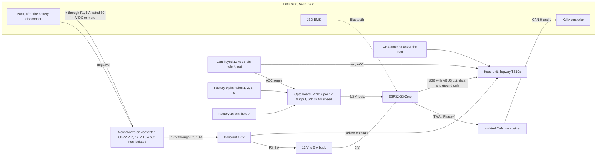

# Wiring

How the new parts connect to the cart. **Status: design, nothing built yet.** Measured facts come from `docs/pinout.md`, the power decision from `docs/plan.md`, and every connection follows the electrical rules in `README.md`.

Things still open are marked **VERIFY** and tracked in `docs/verify.md`.

## Overview



Grounds, in words:
- The new converter is non-isolated, so its input negative and output negative are one conductor, the same as the factory converter. That joins nothing new: the cart's 12V negative is already the pack negative.
- The head unit's black wire and the 5 V buck's negative go to the **new converter's output negative**. That is one ground point for everything that is always on.
- The opto inputs' LED side returns to the **factory plug ground** (9 pin hole 7 or 16 pin hole 2), because the signals come from the cart's wiring. The opto keeps that ground off the ESP32.
- The isolated CAN transceiver's bus side ground goes to the Kelly's CAN ground only, never to the ESP32 ground.
- Nothing is bonded to the cart frame, and that includes the head unit's metal case: mount it to plastic or with insulating washers.

## Power

| # | From | To | Wire | Fuse | Notes |
|---|---|---|---|---|---|
| 1 | Pack positive, on the load side of the battery disconnect | F1, then converter IN+ | 18 AWG | **F1: 5 A, DC rating 80 V or more**, within a few inches of the tap | Ordinary automotive blade fuses are rated 32 V and are **not** safe here: at 73 V a 32 V fuse may not put out its arc. Use a fuse and holder rated for at least 80 V DC. |
| 2 | Pack negative, load side of the disconnect | Converter IN- | 18 AWG | | |
| 3 | Converter OUT+ | F2, then the constant 12 V bus | 14 AWG | F2: 10 A blade (12 V side, so blade fuses are fine) | |
| 4 | Constant 12 V bus | Head unit yellow (constant) | 14 AWG to the head unit plug | | The head unit's running power. ACC is only a signal. |
| 5 | Constant 12 V bus | F3, then 12 V to 5 V buck IN+ | 20 AWG | F3: 2 A blade | |
| 6 | 5 V buck OUT+ | ESP32 5V pin | 20 AWG | | |
| 7 | Converter OUT- | Head unit black, buck IN- and OUT-, ESP32 GND | 14 AWG to the head unit, 20 AWG to the buck | | The single ground point for the always-on parts. |
| 8 | Cart keyed 12 V, 16 pin hole 4 (red) | Head unit red (ACC), and the ACC opto input | 22 AWG | | Signal current only. |
| 9 | Headlights, 9 pin hole 2 (gray/yellow) | Head unit orange (ILL), optional | 22 AWG | | Only if the head unit's own night dimming is wanted. The app has its own night theme. |

Where the converter sits: near the pack (under the seat), so only fused 12 V runs forward to the dash and the pack wiring stays short. The factory harness already runs 68 V to the dash on 9 pin hole 8; this design adds nothing at pack voltage up front.

Not connected, tape off each end:
- **9 pin hole 8 (red/blue): pack voltage, 68 V with the key on.**
- 16 pin hole 1 (light blue): no signal found.
- 16 pin holes 13 to 16: the factory screen's speaker outputs, to speakers that are no longer connected. The head unit's speaker outputs could use these wires later.
- Head unit orange/black (Key1) and brown (Key2): steering wheel controls, none on the cart.

## Inputs to the ESP32 (Phase 2)

| Signal | Source (screen side hole, wire color) | Input part | GPIO | Firmware field | Notes |
|---|---|---|---|---|---|
| ACC | 16 pin hole 4, red | PC817 | 1 | sleep and wake | Light sleep 60 s after ACC off, wakes on ACC on |
| Left turn | 9 pin hole 1, orange | PC817 | 2 | `turn_left` | Blinker latch in firmware |
| Right turn | 9 pin hole 6, pink | PC817 | 4 | `turn_right` | |
| Headlights | 9 pin hole 2, gray/yellow | PC817 | 5 | `low_beam`, `illum` | Reads 0.4 V when off, below the opto's turn-on point |
| Forward gear | 16 pin hole 7, white | PC817 | 6 | `gear` | Check after the Kelly swap that it still works |
| Speed pulse | 9 pin hole 9, yellow | 6N137 | 7 | `speed_mph` through PCNT | **VERIFY** the amplitude, push-pull or open collector, and pulses per wheel turn before building this channel. Source unknown: may stop after the Kelly swap, then Kelly RPM takes over. |
| Brake, park brake, high beam, reverse, speed mode | Not at the plugs: tapped at their switches in Phase 2 | PC817 each | 8, 9, 10, 11, 12 | `brake`, `park_brake`, `high_beam`, `reverse`, `speed_mode` | Find each wire with a meter at its switch |

The opto LED return for every channel above is the factory plug ground (9 pin hole 7 or 16 pin hole 2).

### One 12 V input channel

```
 cart 12 V signal ──[ 2.2 k, 1/4 W ]──┬──────── PC817 pin 1 (anode)
                                      │
                                  1N4148 (cathode to pin 1, anode to pin 2)
                                      │
 cart ground (plug black) ────────────┴──────── PC817 pin 2 (cathode)

 ESP32 GPIO (internal pull-up on) ───────────── PC817 pin 4 (collector)
 ESP32 GND ──────────────────────────────────── PC817 pin 3 (emitter)
```

- The GPIO reads low while the signal is on. A broken or unplugged wire turns the LED off, the pull-up reads high, and firmware reads that as off. That meets the rule that every input is safe (off) when disconnected.
- 2.2 k gives about 5 mA at 12 V and 6 mA at 14.4 V, which is plenty for a PC817 to pull a GPIO low.
- The 1N4148 protects the LED from reverse spikes.
- A ready-made 8 channel PC817 board works too, if its input resistors suit 12 V and its outputs are open collector. Pull the outputs up to the ESP32's 3.3 V, never to 5 V.

The speed pulse uses a 6N137 because a PC817 is too slow for a fast pulse train. A 6N137 runs on 5 V; pull its output up to 3.3 V with an external 4.7 k, not to 5 V. Its input resistor depends on the pulse amplitude, which is still to be measured.

## Data links

| Link | Between | How | Notes |
|---|---|---|---|
| USB | ESP32 USB-C and one of the head unit's USB cables | A USB cable or inline adapter with VBUS cut: data and ground only | The ESP32 has its own 5 V; neither side may power the other. **VERIFY** on the bench that the ESP32 still shows up with VBUS cut (Phase 1). |
| CAN (Phase 4) | ESP32 TWAI and the Kelly | An isolated transceiver with built-in isolated power (an ADM3053 module) is simplest. An ISO1050 also needs a small isolated 5 V supply for its bus side. | Termination: 120 ohms at each end of the bus; check whether the Kelly has its own. **VERIFY** that the Kelly exposes CAN at all. |
| BMS | ESP32 and the JBD BMS | Bluetooth LE | **VERIFY** the signal strength at the ESP32's mounting spot (`docs/bms_test.md`, step 5). |
| GPS | Head unit and its antenna | The head unit's GPS antenna lead | Antenna under the cart roof with a clear view of the sky. |
| FM radio | Head unit antenna input and the factory FM antenna lead | The lead comes up through the dash pod's floor with a Motorola plug (`docs/bezel.md`) | Optional, only for FM radio. |

## ESP32 pins

Assigned 2026-11-24 from Waveshare's S3-Zero pin definition. The board is 18 x 23.5 mm. The same map is in `firmware/include/config.h` and `docs/pinout.md`; change all three together.

| GPIO | Where on the board | Signal | Phase |
|---|---|---|---|
| 1 | Left edge | ACC (wake) | 2 |
| 2 | Left edge | Left turn | 2 |
| 4 | Left edge | Right turn | 2 |
| 5 | Left edge | Headlights | 2 |
| 6 | Left edge | Forward gear | 2 |
| 7 | Right edge | Speed pulse (6N137, external 4.7 k pull-up to 3.3 V for clean edges) | 2 |
| 8 | Right edge | Brake | 2 |
| 9 | Right edge | Park brake | 2 |
| 10 | Right edge | High beam | 2 |
| 11 | Right edge | Reverse | 2 |
| 12 | Right edge | Speed mode | 2 |
| 14 | Pad on the top side, beside the right edge | CAN TX to the isolated transceiver | 4 |
| 15 | Pad on the top side, beside the right edge | CAN RX from the isolated transceiver | 4 |
| 21 | Onboard | WS2812 RGB status LED | |
| 13, 16 | Right edge, top side pad | Spare (a second speed mode wire, if the switch has three positions) | |

Power pins on the left edge: 5V (from the 12 V to 5 V buck), GND, and 3V3 (an output, for the opto pull-ups if a board needs them).

How the pins were chosen:
- All 11 inputs are on the edge pins, so they solder to a header or carrier board. All of them can also wake the chip from deep sleep.
- Left unused on purpose:
  - 3, a strapping pin. It is on the left edge, but keep it free.
  - 43 and 44, UART0 TX and RX on the right edge. The ROM drives TX at boot, and the pair stays free for a debug serial.
  - 17, 18, 38 to 42, and 45: pads on the bottom of the board, hard to reach. 45 is a strapping pin anyway.
  - 19 and 20 (USB) and 26 to 32 (flash and PSRAM) are not broken out.
- The CAN controller (TWAI) and the pulse counter (PCNT) go through the pin matrix, so any GPIO works for them.
- **VERIFY**: whether the board's USB VBUS reaches the 5V pin directly or through a diode. Either way the USB cable to the head unit has VBUS cut.

## Parts still to buy

Nothing here is ordered yet except the ESP32 boards and the two screen-side plugs.

| Part | For | Notes |
|---|---|---|
| Always-on converter, 60-72 V to 12 V, 10 A | Power | Input range covering at least 50 to 80 V, non-isolated is fine, low no-load current (ideally under 20 mA) |
| F1: 5 A fuse and inline holder, rated 80 V DC or more | Pack tap | Not a standard automotive blade fuse |
| F2: 10 A and F3: 2 A blade fuses, with inline holders | 12 V side | |
| 12 V to 5 V buck, 2 A or more | ESP32 | Input rated to at least 20 V |
| PC817 optos with 2.2 k resistors and 1N4148 diodes (or an 8 channel PC817 board) | Phase 2 inputs | 11 channels in the end: 6 now, 5 at the Phase 2 taps |
| 6N137 with its resistors | Speed pulse | Wait until the pulse is measured |
| USB VBUS blocker, or a USB-C to USB-A cable with VBUS cut | USB link | Data and ground only |
| Isolated CAN module (ADM3053) | Phase 4 | Can wait until the Kelly is in |
| Wire: 14 AWG red and black, 18 AWG, 22 AWG in several colors; ring terminals; heat shrink | All | |
| Small enclosure (IP54 or better) | ESP32, buck, opto board behind the dash | |
